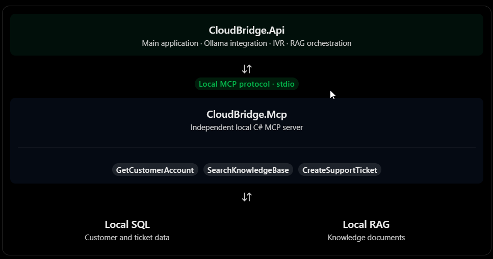
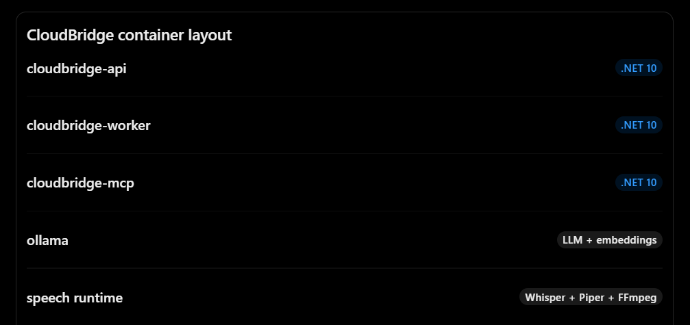
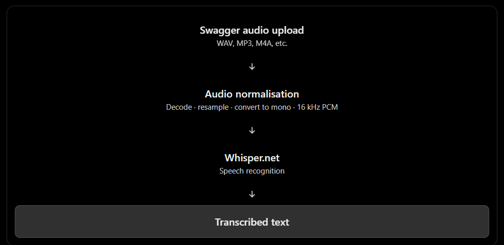
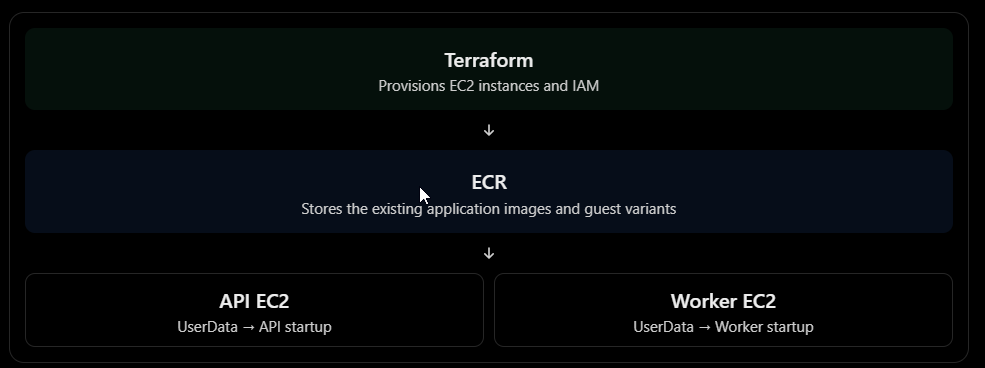

# CloudBridge AI

## Distributed Systems & Applied AI

CloudBridge is a software engineering project exploring the integration of modern .NET technologies, event-driven architecture, AI capabilities and cloud services within a modular application ecosystem.

The project brings together asynchronous communication, speech processing, knowledge retrieval and controlled tool integration through practical implementation.

## UPDATES

YouTube video demo video coming soon...

## Technologies

**Platform**: .NET 10 / ASP.NET Core
**Cloud Infrastructure**: Amazon Web Services (AWS) and Microsoft Azure
**AI Runtime**: Ollama
**Messaging**: Azure Service Bus
**Integration**: Model Context Protocol (MCP)
**Persistence**: SQLite / Azure SQL / Entity Framework Core
**Speech**: Whisper.net and Piper
**Infrastructure as Code**: Terraform
**Containerization**: Docker
**Deployment**: Amazon ECR and Amazon EC2

## 1. Architecture Overview

CloudBridge AI is a hybrid AI platform combining conversational intelligence, knowledge retrieval, speech processing, operational capabilities, and asynchronous business processing.

The architecture separates four fundamental responsibilities:

- **Interaction**: User communication through the ASP.NET Core API and speech interfaces.
- **Intelligence**: AI inference, contextual reasoning, and knowledge retrieval.
- **Execution**: Controlled application services and MCP-integrated capabilities.
- **Processing**: Event-driven background workloads through Azure Service Bus and .NET Worker Services.

The design principle is that AI interprets and recommends, while application services retain authority over business operations and execution.



## 2. High-Level Architecture

```text
flowchart TB
    C[User / Contact Centre]

    subgraph APP["Application Layer"]
        API[ASP.NET Core API]
        ORCH[Conversation Orchestrator]
        VOICE[Whisper.net / Piper]
    end

    subgraph AI["AI Intelligence Layer"]
        LLM[Ollama]
        RAG[Knowledge Retrieval / RAG]
        EMB[Embedding Model]
        MCP[MCP Client]
        MCPS[C# MCP Server]
    end

    subgraph OPS["Operational Layer"]
        DOMAIN[Application Services]
        DB[(SQLite / Azure SQL /EF Core)]
        BUS[Azure Service Bus]
        WORKER[.NET Worker]
        WDB[(Worker Database)]
    end

    subgraph AWS["AWS Infrastructure"]
        EC2[Amazon EC2]
        ECR[Amazon ECR]
        S3[Amazon S3]
        IAM[AWS IAM]
        SG[Security Groups]
    end

    C --> API
    API --> ORCH
    API --> VOICE
    VOICE --> ORCH

    ORCH --> LLM
    ORCH --> RAG
    RAG --> EMB
    ORCH --> MCP
    MCP --> MCPS
    MCPS --> DOMAIN

    DOMAIN --> DB
    DOMAIN --> BUS
    BUS --> WORKER
    WORKER --> WDB

    ECR --> EC2
    EC2 --- API
    EC2 --- WORKER
    IAM --- EC2
    SG --- EC2
    S3 --- AWS
```

The diagram represents logical architecture and infrastructure responsibilities, rather than requiring every component to be independently deployed.

## 3. Application and AI Intelligence

### ASP.NET Core

The .NET API provides the primary application boundary. It manages user interactions, conversations, application services, request validation, and integration with the AI and messaging layers.

### AI orchestration and judgement

Ollama provides the language-model inference runtime. The conversation orchestrator combines user context, conversation history, retrieved knowledge, and available application capabilities to produce contextually relevant responses.

AI-generated output is not treated as authoritative application state.

The architecture maintains a strict distinction:

**The model provides intelligence; the application provides authority.**

The model can interpret intent and request an available capability, but application services remain responsible for validation, authorisation, execution, and confirmation.

### Retrieval-Augmented Generation

The RAG subsystem uses embeddings and semantic retrieval to provide relevant organisational knowledge to the language model.

This grounds responses in application knowledge rather than relying exclusively on pretrained model information.

Retrieved content is treated as reference material, not trusted executable instruction.

### Model Context Protocol

A dedicated C# MCP server exposes structured application capabilities to the AI orchestration layer.

MCP separates tool discovery and protocol interaction from the underlying business implementation. Application-side validation and authorisation remain mandatory.



## 4. Voice Architecture

Whisper.net provides speech-to-text capability, while Piper provides text-to-speech synthesis.

Both capabilities integrate with the shared conversation orchestration pipeline.

This allows voice and text interactions to reuse the same intelligence, knowledge retrieval, and application services instead of maintaining separate conversational implementations.



## 5. Event-Driven Processing

Azure Service Bus provides asynchronous messaging between the API and the .NET Worker Service.

The API publishes business events, while the Worker independently consumes and processes background workloads.

This separates user-facing request processing from asynchronous execution and establishes independent runtime responsibilities.

The API and Worker also maintain separate persistence contexts:

---
**Component**              **Persistence responsibility**

ASP.NET Core API        User and conversation application data

.NET Worker             Worker inbox and operational processing state

---

Entity Framework Core manages application persistence through SQLite. The API database is api.db, while the Worker maintains its separate database.

SQLite provides a lightweight persistence model; it should not be confused with a highly available, horizontally scalable managed relational database.

## 6. Cloud Infrastructure Architecture



### Amazon Web Services

AWS provides the application infrastructure and container distribution layer.

---

**Technology**          **Responsibility**

Amazon EC2              Hosts API and Worker application runtimes

Amazon ECR              Stores and distributes container images

Amazon S3               Object and deployment artifact storage

AWS IAM                 Infrastructure identity and permissions

EC2 Security Groups     Network access control

---

API and Worker workloads have separate runtime responsibilities, allowing their infrastructure requirements to be managed independently.

### Microsoft Azure

**Azure Service Bus** provides the asynchronous messaging infrastructure connecting application operations with background processing.

The architecture therefore combines AWS compute and infrastructure capabilities with Azure-managed messaging through explicit application integration boundaries.

## 7. Infrastructure as Code — Terraform

Terraform provides declarative infrastructure management for the AWS environment.

The Terraform configuration is maintained under:

**`infra/terraform/aws`**

It manages the principal AWS infrastructure resources:

- EC2 instances for API and Worker workloads.
- ECR repositories for application container images.
- S3 artifact storage.
- IAM roles and instance profiles.
- Security groups for network access control.

Terraform state provides the mechanism for tracking managed infrastructure and reconciling declared configuration with deployed resources.

This establishes infrastructure provisioning as a controlled, versioned engineering discipline rather than a collection of manually configured cloud resources.

Terraform manages the AWS infrastructure boundary; Azure Service Bus remains an external application dependency.

## 8. CI/CD and Container Deployment

The deployment architecture separates infrastructure provisioning from application delivery.

Terraform defines the infrastructure. CI/CD manages application artifact delivery.

The application is distributed through separate API and Worker container images:

- **cloudbridge/api**

- **cloudbridge/worker**

Amazon ECR acts as the central container registry, with Amazon EC2 providing the deployment runtime.

The CI/CD workflow uses existing, prebuilt container images. It handles image identification, tagging, AWS authentication, and pushing the images to their corresponding ECR repositories.

The deployment workflow deliberately excludes application compilation and container image construction. It is an artifact promotion and delivery mechanism, not a build pipeline.

The supporting technologies include Docker, AWS CLI, GitHub Actions-compatible workflows, and act for local workflow validation.

This separation provides three independent architectural boundaries:

1. **Application artifacts**: Existing, versioned container images.
2. **Infrastructure**: Terraform-managed AWS resources.
3. **Deployment**: Controlled delivery of container images through ECR to EC2.

## 9. Security and Operational Architecture

Security is enforced across infrastructure, application, messaging, and AI boundaries.

- AWS IAM governs infrastructure permissions.
- Security groups control network access.
- Application services enforce validation and business authorisation.
- MCP capabilities remain subject to application-side execution controls.
- Azure Service Bus provides the messaging boundary.
- Database access remains within the relevant application runtime.

AI-specific risks, including prompt injection, malicious retrieved content, unauthorised tool invocation, and fabricated execution outcomes, require explicit application controls.

Correlation middleware provides a foundation for request tracing. Production observability should extend this with structured logging, distributed tracing, service metrics, queue monitoring, and model inference monitoring.

## 10. Architectural Assessment

CloudBridge AI is distinguished by the integration of AI intelligence into a controlled, event-driven application architecture.

Its principal strengths are:

---

**Capability**                  **Architectural value**

AI orchestration                Contextual reasoning across conversations and application capabilities

RAG                             Knowledge-grounded AI responses

MCP                             Structured integration between AI and application tools

Unified voice and text          Shared conversational intelligence across interaction channels

Azure Service Bus               Decoupled asynchronous processing

Independent Worker              Separation of user interaction from background execution

Terraform                       Declarative and reproducible AWS infrastructure

Amazon ECR and EC2              Centralised container distribution and application runtime

IAM and security groups         Infrastructure identity and network controls

---

The architecture establishes a meaningful separation between intelligence, execution, persistence, messaging, and infrastructure.

Its defining engineering principle is:

AI may interpret intent and request action, but deterministic application controls retain authority over execution and business outcomes.

That distinction is fundamental to building an operational AI contact centre rather than simply connecting a chatbot to business data.

The architecture provides a foundation for further production hardening in distributed reliability, database availability, security governance, model evaluation, and end-to-end observability.

## Project Visibility

CloudBridge is maintained as a private project. Its source code and internal implementation are not publicly available yet, exciting bits to be shown publicly.

This page provides a high-level overview of its technologies, capabilities and architectural direction. Additional visual documentation, architecture diagrams and technical insights may be introduced as the project evolves.

☄️ Shipping soon. ⏳

## Author

Created and Maintained by: [Ethern-Myth](https://github.com/ethern-myth)
